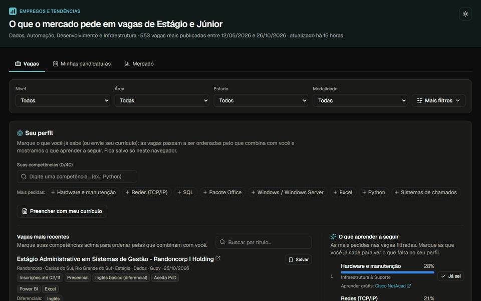
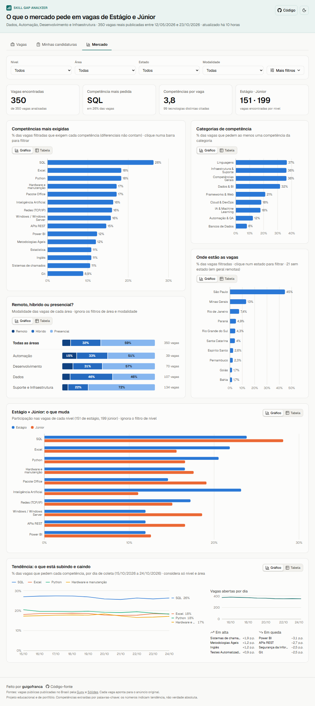
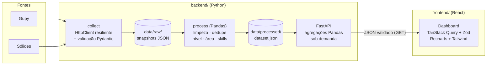

# Skill Gap Analyzer

**O que as vagas de Estágio e Júnior em tecnologia pedem, e o que falta no seu perfil.**
Dashboard com vagas reais do Brasil (Gupy e Sólides) em Dados, Automação, Desenvolvimento e
Infraestrutura, atualizado todo dia por um pipeline ETL em Python.

**🔗 Acesse: [seu-empregobr.vercel.app](https://seu-empregobr.vercel.app)** · feito por [@guigofranca](https://github.com/guigofranca)




[](https://github.com/guigofranca/job-market-skill-gap-analyzer/actions/workflows/ci.yml)

## Em 30 segundos

**Para quem procura vaga**
- Marque o que você sabe (ou envie o PDF do currículo, lido só no navegador) e veja as vagas
  ordenadas pelo que falta: *prontas para aplicar*, *falta 1 competência*, todas.
- Cada vaga diz o que fecha a lacuna (*"Falta só Power BI, pedida em 12% das vagas"*) e onde
  aprender grátis.
- Acompanhe suas candidaturas e prazos (com exportação para o calendário), compartilhe seu
  perfil por link e veja quais competências estão em alta.

**Destaques técnicos**
- **ETL diário no GitHub Actions**: coleta 2 fontes com um cliente HTTP resiliente, limpa e
  deduplica com Pandas, classifica nível e área e extrai 110 competências com regex testadas.
  Uma checagem de sanidade impede publicar um dataset quebrado.
- **API FastAPI somente leitura na Vercel**: agregações com Pandas, cache na CDN até a
  meia-noite de Brasília, *rate limit*, CSP e cabeçalhos de segurança.
- **React 19 + TypeScript estrito**: Zod valida toda resposta da API; TanStack Query; cada
  gráfico (Recharts) tem uma tabela acessível; tema claro e escuro.
- **Qualidade**: 322 testes no backend (pytest, 94% de cobertura) e 148 no frontend (Vitest),
  E2E com Playwright e checagem de acessibilidade (axe) no celular e no desktop; `mypy --strict`,
  ruff, oxlint, CodeQL, gitleaks e Dependabot no CI.

> Perguntas que o projeto responde:
> - Quais tecnologias aparecem em mais vagas de estágio em Dados? E de júnior em Desenvolvimento?
> - O que muda entre os requisitos de Estágio e de Júnior?
> - Quem pede Python costuma pedir o quê junto? E o que está subindo ou caindo?
> - Eu sei SQL e Excel: quantas vagas eu cubro e qual competência me abre mais portas?

## In English

Skill Gap Analyzer is a full-stack dashboard of real entry-level tech job postings in Brazil
(internships and junior roles in data, automation, software development and IT support). A daily
ETL pipeline (Python, Pandas, GitHub Actions) collects postings from two job boards, extracts 110
skills with tested regex rules and publishes a dataset. A read-only FastAPI service aggregates it
on demand, and a React + TypeScript dashboard lets job seekers rank openings by the skills they
already have, see what they are missing and where to learn it for free, track their applications
and follow which skills are trending. The interface is in Portuguese.

---

## Sumário

1. [Funcionalidades](#funcionalidades)
2. [Fontes de dados reais](#fontes-de-dados-reais)
3. [Arquitetura](#arquitetura)
4. [Estrutura do repositório](#estrutura-do-repositório)
5. [Como a análise funciona](#como-a-análise-funciona)
6. [Segurança e boas práticas](#segurança-e-boas-práticas)
7. [Como rodar localmente](#como-rodar-localmente)
8. [Deploy na Vercel](#deploy-na-vercel)
9. [API REST](#api-rest)
10. [Qualidade: testes, lint e CI](#qualidade-testes-lint-e-ci)
11. [Adicionando uma nova fonte de vagas](#adicionando-uma-nova-fonte-de-vagas)
12. [Limitações e próximos passos](#limitações-e-próximos-passos)

---

## Funcionalidades

**Backend (Python)**
- Pipeline ETL modular: `collect` (extração) → `process` (limpeza, classificação, extração de
  skills com **Pandas**) → `dataset.json` (carga).
- Coleta de **2 fontes reais do mercado brasileiro** (Gupy e Sólides, sem chave de API)
  com cliente HTTP resiliente (timeouts, *retries* com *backoff*, limite de tamanho de resposta,
  intervalo mínimo entre requisições). Vagas fora do Brasil são descartadas.
- Taxonomia de **110 competências** em 9 categorias (Python, SQL, Power BI, Databricks, Java, React,
  Git, UiPath, Inglês…), detectadas com expressões regulares que evitam falsos positivos clássicos
  (`R$ 1.500` não é a linguagem R, *"to excel at"* não é Excel, *Spring 2026* não é Spring Boot).
- API **FastAPI** somente leitura que agrega os dados sob demanda com Pandas (filtros por nível,
  área, local, modalidade, inclusão e tecnologia).

**Frontend (React + Tailwind + Recharts)**



- Três abas (a aba ativa também vai para a URL, `?aba=mercado`):
  - **Vagas** (padrão), para quem procura emprego, num fluxo só:
    1. **Seu perfil** — marque o que já sabe (busca por nome, sem acento: "estatis" acha
       *Estatística*, ou clique nas sugestões das mais pedidas), ou
       **envie o PDF do seu currículo** (também serve o PDF do LinkedIn ou um .txt): o arquivo é
       lido no próprio navegador com pdf.js (não é enviado nem guardado), as competências
       encontradas aparecem marcadas e você desmarca o que não se aplica. O perfil pode ser
       **compartilhado por link** (`?perfil=python,sql`): quem abre vê a oferta e aplica com um
       clique. No celular, o perfil fica recolhido numa linha para as vagas aparecerem logo;
    2. **Uma única lista de vagas** — sem perfil, as mais recentes; com perfil, ordenadas pelo que
       falta, com abas *Prontas para aplicar*, *Falta 1 competência* e *Todas*, o que você já tem
       (✓) e o que falta em cada anúncio, busca por título e paginação. Vagas publicadas e
       encontradas desde a sua última visita ganham a etiqueta **Nova para você** e podem ser
       listadas sozinhas. Vagas cujo anúncio você abriu mostram **vista há 3 horas** e podem ser
       ocultadas ou listadas sozinhas (guardado só neste navegador, por 30 dias). Os benefícios
       citados no anúncio aparecem numa linha discreta (vale-refeição, plano de saúde,
       Gympass...), nunca o texto do anúncio;
    3. **O que aprender a seguir** — cobertura média e as competências que mais aproximam você das
       vagas (com quantas vagas cada uma deixa "prontas"; sem perfil, as mais pedidas nas vagas
       filtradas), cada uma com **onde aprender grátis**
       (curso ou documentação oficial, em português quando existe); o botão
       *Já sei* adiciona ao perfil.

    Com perfil, cada vaga diz o que fecha a lacuna: *"Falta só Power BI, pedida em 16% das
    vagas"* (com os links para aprender) ou, quando faltam várias, por qual começar.
  - **Minhas candidaturas**: as vagas salvas com o botão **Salvar** de cada vaga, agrupadas por
    etapa (*salva*, *candidatei-me*, *em processo seletivo*, *recebi proposta*, *encerrada*), com
    prazo, anotação e aviso quando a vaga **não está mais publicada**. Vagas salvas que encerram
    em até 7 dias sem candidatura geram um lembrete no topo do painel. A vaga salva é guardada no
    navegador (até 200), então continua na lista mesmo depois de sair das fontes. A lista pode
    ser **exportada e importada** (backup em JSON, validado item a item) e os prazos vão para o
    calendário (Google Agenda, Outlook, celular) num arquivo **.ics**, com lembrete na véspera.
  - **Mercado**, para entender o que as vagas filtradas pedem: KPIs, ranking de competências (clique numa barra para
    filtrar), categorias, comparação **Estágio × Júnior** e **tendência** (participação das
    competências por dia de coleta, vagas abertas por dia, e o que está em alta ou em queda).
- Filtros sincronizados com a URL — qualquer visão pode ser compartilhada como link. Sempre
  visíveis: nível, área, estado e modalidade; em **Mais filtros**: cidade, **inclusão** (vagas que
  aceitam PcD e vagas afirmativas para PcD, mulheres, pessoas negras, indígenas, LGBTQIAPN+ e
  pessoas 40+) e tecnologia.
  No celular, o painel inteiro fica recolhido em um botão **Filtros**.
- Cada vaga mostra prazo de inscrição (com destaque quando encerra em até 3 dias), salário
  quando informado, modalidade, contrato, carga horária, inglês, semestre/formatura pedidos,
  etiquetas de inclusão e as competências separadas em **exigidas** e **diferenciais** (estas
  nunca contam como "falta").
- O cabeçalho mostra há quanto tempo os dados foram atualizados e avisa quando passam de 3 dias.
- Tema claro/escuro, layout responsivo e visualização em **tabela** para todo gráfico (acessibilidade).
- Títulos de vaga escritos todo em maiúsculas são exibidos em formato de título
  ("ANALISTA DE SUPORTE JR - SP" → "Analista de Suporte Jr - SP"), mantendo siglas.
- Quando o anúncio cita só uma competência técnica, o "100%" vem com o aviso *poucos requisitos
  no anúncio*: compatibilidade alta com pouca evidência.

---

## Fontes de dados reais

| Fonte | Cobertura | Acesso | Observações |
|---|---|---|---|
| **Gupy** | Grandes e médias empresas | Endpoint público usado pelo portal `portal.gupy.io` (sem chave) | Traz o tipo da vaga (`vacancy_type_internship`), o que melhora a classificação de estágio. A Gupy também hospeda algumas vagas no exterior (México, Argentina…): elas são descartadas. |
| **Sólides** | Pequenas e médias empresas | Endpoint público usado pelo portal `vagas.solides.com.br` (sem chave) | Busca filtrada pela área *Tecnologia* (estágio pelo título, júnior pelo filtro de senioridade). Inclui as *hard skills* cadastradas na vaga. |

Gupy e Sólides não têm APIs oficialmente documentadas: os endpoints são os mesmos que os
próprios sites usam, consumidos para fins educacionais, com baixa taxa de requisições e guardando só
o necessário para estatísticas agregadas. Se um contrato mudar, os itens falham na validação e são
contados como inválidos, sem derrubar o pipeline.

<details>
<summary>Fontes avaliadas e não incluídas</summary>

| Fonte | Motivo |
|---|---|
| LinkedIn, Indeed, Catho, Vagas.com, InfoJobs | Sem API pública; os termos de uso proíbem coleta automatizada. |
| Remotar | Os termos de uso proíbem robôs/*crawlers* e a reprodução do conteúdo do site: removida em 15/10/2026. |
| Programathor | Só HTML e, na data da avaliação, menos de 20 vagas de estágio/júnior abertas. |
| Repositórios de vagas no GitHub (`backend-br/vagas`, `frontendbr/vagas`…) | API oficial, mas ~15 vagas de estágio/júnior em 6 meses (a maioria é pleno/sênior). |
| Adzuna | API oficial, mas paga (£8/mês) e só devolve trechos de ~500 caracteres das descrições. |
| Greenhouse / Lever (Stone, C6, XP, QuintoAndar, CI&T…) | APIs oficiais, mas poucas vagas de entrada em tecnologia por empresa e lista de empresas a manter. Boa candidata para uma próxima fonte. |

</details>

O repositório inclui um *snapshot* processado em `backend/data/processed/dataset.json` com
as **vagas reais da coleta mais recente** (algumas centenas), para que o dashboard funcione logo após clonar.
Um GitHub Action atualiza esse snapshot todo dia; rode `job-analyzer run` para atualizar localmente.

**Uso responsável:** o dataset processado guarda apenas título, empresa, local, link, data, nível,
área, as competências detectadas e os benefícios citados (como etiquetas) — **nenhum trecho das
descrições é publicado** (elas ficam só nos snapshots brutos, ignorados pelo Git). Nenhum dado
pessoal de candidatos é coletado. A coleta roda uma vez por dia, com uma requisição por segundo e
um *User-Agent* que identifica o projeto e aponta para este repositório.

**Remoção de dados:** se você representa a Gupy, a Sólides ou uma empresa listada e prefere que
suas vagas não apareçam aqui, abra uma *issue* neste repositório. A fonte pode ser desligada na
hora (`ENABLED_SOURCES`) e as vagas saem do dataset na atualização seguinte.

---

## Arquitetura



**Decisões principais**

- **ETL em lote + API de leitura.** A coleta é lenta e sujeita a limites das fontes; separá-la da
  API mantém o dashboard rápido e estável mesmo se uma fonte sair do ar. A API só lê o
  `dataset.json` e recarrega automaticamente quando o arquivo muda (*hot reload* seguro: se o novo
  arquivo for inválido, continua servindo o último válido).
- **Só vagas ainda publicadas.** Cada coleta gera um snapshot bruto. A coleta mais recente de cada
  fonte define o que está aberto: vaga que saiu da fonte sai do dataset. Se a coleta teve falhas
  (snapshot *parcial*), as anteriores completam a lista, para uma página que falhou não esconder
  vagas abertas. Os snapshots antigos servem para datar quando cada vaga apareceu (`first_seen`).
- **"Nova para você"** = vaga encontrada depois da sua última visita **e** publicada no máximo 3
  dias antes de ser encontrada (um fim de semana sem coleta cabe nisso). Vagas antigas que só
  entraram agora — porque uma fonte ou termo de busca novo as encontrou — não são novidade e não
  ganham a etiqueta. A visita fica salva no navegador; uma pausa de 30 min inicia uma nova visita.
- **Agregação no servidor com Pandas.** O frontend recebe só números prontos (não o dataset
  inteiro), e cada widget faz sua própria requisição: se um falhar, os outros continuam funcionando.
- **Contratos validados nas duas pontas.** Pydantic valida tudo que entra no backend (APIs externas,
  arquivos, query strings) e Zod valida tudo que o frontend recebe da API.

---

## Estrutura do repositório

```
.
├── backend/
│   ├── src/job_analyzer/
│   │   ├── sources/            # Fontes: base.py, brazil.py + gupy, solides
│   │   ├── processing/         # text.py, cleaning.py (Pandas), classification.py, skills.py,
│   │   │                       # sections.py (exigido × diferencial), eligibility.py (requisitos)
│   │   ├── analytics/          # Agregações com Pandas, tendências e repositório com hot reload
│   │   ├── api/                # FastAPI: app, rotas, parâmetros, middlewares, erros
│   │   ├── config.py           # Configuração via variáveis de ambiente (pydantic-settings)
│   │   ├── http_client.py      # Retries, backoff, timeouts, limite de resposta
│   │   ├── storage.py          # Escrita atômica, proteção contra path traversal
│   │   ├── pipeline.py         # Orquestração collect → process
│   │   └── cli.py              # job-analyzer collect | process | run | serve
│   ├── scripts/                # collect.ps1 e schedule-collection.ps1 (coleta diária no Windows)
│   ├── tests/                  # 322 testes (pytest)
│   ├── data/processed/         # dataset.json (snapshot versionado)
│   ├── .env.example
│   ├── app.py + vercel.json    # Entrada da API como Vercel Function
│   ├── Dockerfile
│   └── pyproject.toml          # dependências + config de ruff, mypy e pytest
├── frontend/
│   ├── src/
│   │   ├── api/                # Cliente HTTP (timeout, AbortSignal) + schemas Zod
│   │   ├── components/         # applications/, charts/, dashboard/, feedback/ (ErrorBoundary, estados), layout/
│   │   ├── hooks/              # Queries (TanStack Query), filtros na URL, tema, perfil do gap
│   │   ├── lib/                # Formatação pt-BR, URLs seguras, storage seguro, paleta
│   │   └── config/env.ts       # Validação das variáveis VITE_*
│   ├── public/og-image.png     # Imagem da prévia de link (LinkedIn, WhatsApp)
│   ├── .env.example
│   ├── Dockerfile + nginx.conf
│   ├── vercel.json             # Cabeçalhos de segurança e cache na Vercel
│   └── vite.config.ts          # Plugins que injetam a Content-Security-Policy e a prévia de link
├── docs/                       # Captura de tela do README
├── .github/                    # CI (lint, tipos, testes, build, auditoria, gitleaks), coleta diária + Dependabot
├── .pre-commit-config.yaml
└── docker-compose.yml
```

---

## Como a análise funciona

1. **Coleta.** Cada fonte implementa só duas coisas: iterar sobre os itens da API e mapear um item
   para o modelo comum `RawJob`. A classe base valida cada item com Pydantic (URLs `http(s)`
   obrigatórias, tamanhos máximos, datas com fuso, datas futuras descartadas), conta inválidos e
   duplicados, pula vagas fora do escopo (fora do Brasil, encerradas) e erros de uma página não
   derrubam a coleta inteira.
2. **Limpeza (Pandas).** HTML removido, entidades decodificadas, caracteres de controle/invisíveis
   eliminados, vagas antigas (`MAX_JOB_AGE_DAYS`) descartadas e duplicatas removidas em dois níveis:
   mesmo ID na fonte **e** mesmo anúncio republicado (título + empresa + hash do texto) — assim uma
   empresa que publica a mesma vaga em 10 cidades não infla a demanda por uma skill.
3. **Nível.** Pelo título (`estágio`, `estagiário(a)`, `intern`, `júnior`, `jr`, `trainee`…) e,
   se o título não diz, pelas dicas da fonte (tipo `internship` da Gupy, senioridade da Sólides —
   ignoradas quando ambíguas, como "Júnior + Sênior"). Títulos pleno/sênior/
   *mid-level* e programas de Jovem Aprendiz ficam fora do escopo.
4. **Local, modalidade, contrato e inclusão.** Vêm primeiro dos campos estruturados das fontes
   (estado/cidade, `workplaceType` da Gupy, tipo de contrato e etiquetas afirmativas da
   Sólides). Lacunas são preenchidas por regras conservadoras: o **título** vale ("Vaga
   afirmativa para mulheres", "Analista PcD"), mas na **descrição** só frases explícitas ("vaga
   exclusiva para…") contam — "incentivamos candidaturas de mulheres" é declaração de diversidade,
   não vaga afirmativa. "Inclusivo para PcD" marca a vaga como *aceita PcD*, não como exclusiva.
   Estágio sem contrato informado é contrato de estágio.
5. **Área.** Regras por título em ordem de especificidade (Automação → Dados → Suporte e
   Infraestrutura → Desenvolvimento). **Suporte e Infraestrutura** reúne suporte técnico, help
   desk, NOC, redes, infraestrutura, cloud e segurança da informação — a principal porta de
   entrada em TI para quem não tem experiência. Técnicos de campo (fibra óptica, instalação),
   compras de TI e suporte ao cliente/paciente ficam de fora. Títulos genéricos ("Estágio em TI",
   "Analista de Suporte") são classificados pelas competências pedidas, desde que haja sinal
   suficiente; caso contrário, ficam de fora.
6. **Exigido × diferencial.** A descrição é separada em seções (`processing/sections.py`):
   requisitos e responsabilidades contam como **exigidos**; "Diferenciais", "Desejável" e
   frases como "Power BI será um diferencial" contam como **diferencial**; "Sobre a empresa",
   "Benefícios", "Informações adicionais" e frases em que a empresa fala de si ("somos uma
   empresa de IA") são **ignoradas**. Os rankings e a compatibilidade usam só as exigidas.
7. **Competências.** 110 padrões regex sobre o texto sem acentos (`Estatística` = `Estatistica`).
   Os mesmos padrões são servidos em `GET /api/v1/skills/patterns` para o navegador ler um
   currículo localmente (validado: resultado idêntico ao Python em 939 descrições reais).
8. **Quem pode se candidatar** (`processing/eligibility.py`). Do texto **exigido** saem: cursos
   pedidos (e se a lista é só exemplo, "ou áreas afins"), **superior completo**, faixa de
   **semestre** ("a partir do 4º período", "entre o 4º e o 7º semestre", "a partir do 3º
   ano"), **previsão de formatura** ("a partir de 2028.1", "entre 06/2028 e 12/2028") e
   **inglês** com o nível mínimo ("intermediário a avançado" → intermediário; "técnico" /
   "leitura" → básico); inglês só em "Diferenciais" vira *diferencial*. A **carga horária**
   ("6h por dia" → 30h/semana) vem da descrição inteira. Só frases explícitas contam:
   "pelo menos 1 ano de experiência" não é semestre. Estágio nunca exige superior completo
   (Lei 11.788/2008). Esses requisitos aparecem como etiquetas em cada vaga ("Superior
   completo", "Inglês intermediário", "A partir do 4º semestre", "30h/semana"). A API também
   aceita um perfil (`semester`, `graduated`, `course`, `english`) e devolve, por vaga, os
   requisitos que ele não atende (`conflicts`), com opção de escondê-las (`hide_ineligible`).
9. **Prazo e salário.** Vagas com prazo de inscrição (Gupy) vencido são descartadas. Salário
   só aparece quando a empresa o exibe (Sólides): "simples" = um valor, "faixa" = mínimo e
   máximo; valores fora de R$ 500–50.000/mês são descartados.
10. **Métricas.**
   - **Participação** = vagas que exigem a competência ÷ vagas filtradas.
   - **Cobertura do gap** = |skills que você tem ∩ skills da vaga| ÷ |skills da vaga|.
   - **"Destrava N vagas"** = vagas em que aquela competência é a **única** que falta no seu perfil.

O relatório do processamento mostra quantos registros saíram em cada etapa (exemplo de uma coleta):

```
Processamento
  saíram do ar desde coletas anteriores       0
  registros brutos (ainda publicadas)      1009
  sem título                                  0
  mais antigas que 180 dias                  60
  inscrições encerradas                       0
  duplicadas                                 13
  fora do escopo (nível)                     89
  fora do escopo (área)                     380
  vagas no dataset                          467
```

---

## Segurança e boas práticas

| Requisito | Como foi implementado |
|---|---|
| **Gestão de segredos** | Nenhuma credencial no código. Backend lê tudo de variáveis de ambiente / `backend/.env` via `pydantic-settings`. As fontes atuais não exigem chave; credenciais futuras devem ser `SecretStr` (mascaradas em `repr`, logs e tracebacks). Modelos `.env.example` nos dois projetos; `.env` no `.gitignore`. URLs das APIs também são configuráveis. |
| **Vazamento de segredos em logs** | As fontes atuais não usam chave, mas a proteção já existe para a próxima: o log de requisições do `httpx` é silenciado e um filtro de logging mascara `app_key=`, `token=`, etc. Mensagens de erro usam `redact_url()`. Testado. |
| **Segredos no frontend** | Documentado que variáveis `VITE_*` são públicas (vão para o bundle); o frontend só recebe a URL da API. |
| **Varredura de segredos** | `gitleaks` no pre-commit e no CI; hook `detect-private-key`. |
| **Validação de entrada (backend)** | Pydantic em todas as fronteiras: respostas das APIs externas, arquivos lidos do disco (com limite de tamanho), variáveis de ambiente e query params da API (`extra="forbid"`, enums, limites numéricos, skills validadas contra a taxonomia, texto com tamanho máximo). |
| **Validação de entrada (frontend)** | Zod valida configuração (`VITE_*`), toda resposta da API, filtros vindos da URL e dados do `localStorage`. Valores inválidos são descartados, não renderizados. |
| **XSS** | React escapa o conteúdo; nenhum `dangerouslySetInnerHTML` (regra de lint). Links de vagas passam por `toSafeHref` (só `http/https`) e abrem com `rel="noopener noreferrer"`. **Content-Security-Policy** estrita injetada no build (`script-src 'self'`, `connect-src` restrito à API). |
| **Injeção / ReDoS** | Busca textual da API usa `str.contains(..., regex=False)`; parâmetros montados com `URLSearchParams`. |
| **Hardening da API** | Somente `GET`; CORS com lista de origens explícita (sem `*` em produção); `TrustedHost`; *rate limit* por IP (429 + `Retry-After`; na Vercel, aplicado pelo Firewall do projeto); headers `X-Content-Type-Options`, `X-Frame-Options`, CSP, `Referrer-Policy`, HSTS em produção; `X-Request-ID` para rastreio; `/docs` desligado em produção; header `Server` do Uvicorn removido (na Vercel, a plataforma adiciona o próprio `Server: Vercel`). |
| **Tratamento de erros (backend)** | Hierarquia de exceções de domínio; uma fonte com falha não interrompe as outras; *retries* com *backoff* exponencial + *jitter* respeitando `Retry-After`; respostas 4xx/5xx sem stack trace; dataset inválido → 503 com mensagem clara, mantendo o último dataset válido. |
| **Tratamento de erros (frontend)** | `ErrorBoundary` na raiz (com tela específica para configuração inválida) **e por seção**; estados de carregando / erro com "tentar novamente" / vazio em cada widget; *retry* automático só para falhas transitórias; dados anteriores mantidos (esmaecidos) durante recarregamentos. |
| **Integridade de dados** | Escrita atômica (arquivo temporário + `os.replace`), proteção contra *path traversal*, limites de tamanho de resposta HTTP e de arquivo. |
| **Contêineres** | Usuário não-root, nginx *unprivileged*, sistema de arquivos somente leitura, `no-new-privileges`, `cap_drop: ALL`, portas ligadas só em `127.0.0.1`. |
| **Dependências** | Versões com faixas no `pyproject.toml`/`package.json` + lockfile npm; `pip-audit` e `npm audit` no CI; Dependabot semanal. |
| **Código** | Tipagem estrita (`mypy --strict`, TypeScript `strict` + `noUncheckedIndexedAccess` + `exactOptionalPropertyTypes`), `ruff` (inclui regras de segurança `bandit`), `oxlint` (inclui `jsx-a11y`), Prettier, EditorConfig. |

---

## Como rodar localmente

### Pré-requisitos

- **Python 3.12+**
- **Node.js 20.19+ ou 22.12+** (exigência do Vite 8)
- (Opcional) Docker

### 1. Backend

```bash
cd backend
python -m venv .venv

# Windows (PowerShell)
.venv\Scripts\Activate.ps1
# Linux / macOS
source .venv/bin/activate

pip install -e ".[dev]"
cp .env.example .env          # Windows: copy .env.example .env  (opcional: os padrões funcionam)
```

Atualizar os dados (opcional — já existe um snapshot pronto):

```bash
job-analyzer run              # collect + process (~2–3 min, respeitando o rate limit das fontes)
job-analyzer collect --sources gupy    # só coletar de uma fonte
job-analyzer process          # só reprocessar os snapshots já coletados
job-analyzer history          # acrescenta o dataset atual ao histórico diário (feito pelo Action)
```

Atualização diária automática no Windows (Agendador de Tarefas; a API em execução recarrega
o dataset sozinha, sem reiniciar):

```powershell
pwsh scripts/schedule-collection.ps1             # todo dia às 08:00 (ou -At 19:30)
pwsh scripts/schedule-collection.ps1 -Remove     # remove a tarefa
pwsh scripts/collect.ps1                         # uma coleta agora, com log em logs/collect.log
```

Se o computador estiver desligado no horário, a coleta roda assim que ele ligar.

Subir a API:

```bash
job-analyzer serve            # http://127.0.0.1:8000  ·  docs em http://127.0.0.1:8000/docs
```

### 2. Frontend

Em outro terminal:

```bash
cd frontend
npm ci
cp .env.example .env.local    # Windows: copy .env.example .env.local
npm run dev                   # http://localhost:5173
```

### 3. Alternativa com Docker

```bash
docker compose up --build                          # dashboard em http://localhost:8080
docker compose run --rm api job-analyzer run       # atualizar os dados
```

O Docker sobe o projeto **como em produção**: API com `ENVIRONMENT=production` (sem `/docs`,
validações mais rígidas) e o dashboard compilado servido pelo nginx. Para o dia a dia de
desenvolvimento, prefira os passos 1 e 2 (recarregamento automático). A stack foi verificada:
contêineres sem root, sistema de arquivos somente leitura, `cap_drop: ALL`, *healthcheck* da API,
cabeçalhos de segurança no nginx e na API, e o pipeline rodando dentro do contêiner.

> As portas 8000 e 8080 precisam estar livres (pare o `job-analyzer serve` local antes).

---

## Deploy na Vercel

São dois projetos na Vercel ligados a este repositório, um por pasta (*Root Directory*):

| Projeto | Root Directory | Variáveis de ambiente |
|---|---|---|
| API | `backend` | `ENVIRONMENT=production`<br>`API_CORS_ORIGINS=https://<dashboard>.vercel.app`<br>`API_ALLOWED_HOSTS=<api>.vercel.app`<br>`API_CLIENT_IP_HEADER=x-real-ip` |
| Dashboard | `frontend` | `VITE_API_BASE_URL=https://<api>.vercel.app` |

- A API vira uma Vercel Function a partir de `backend/app.py`, com o `dataset.json` dentro do
  pacote, rodando com *Fluid compute* (`"fluid": true`, menos *cold starts*). A raiz da API
  (`/`) redireciona para o dashboard. Cada commit da coleta diária gera um deploy novo da API com os dados do dia; o
  `vercel.json` de cada pasta pula o build quando o commit não mexe nela, então o dashboard não é
  recompilado todo dia.
- O *rate limit* usa o `x-real-ip`, que a Vercel sempre sobrescreve (o cliente não consegue
  forjar). Ele continua em memória, então conta por instância da função: requisições paralelas
  caem em instâncias diferentes e passam do limite. Por isso o limite real fica numa regra do
  Firewall da Vercel no projeto da API (*Firewall → Configure → New Rule*): *Request Path*
  começa com `/api/` → *Rate Limit*, 300 requisições a cada 60 s, por IP.
- A prévia de link usa o domínio de produção do projeto (`VERCEL_PROJECT_PRODUCTION_URL`); com
  domínio próprio, defina `VITE_SITE_URL`.
- Os cabeçalhos de segurança do dashboard estão em `frontend/vercel.json` (os mesmos do
  `nginx.conf`), e a Content-Security-Policy vem do build.
- No plano Hobby, um repositório **privado** só publica commits do dono da conta: os commits da
  coleta diária só chegam ao site com o repositório público.

---

## API REST

Todos os endpoints são `GET`, retornam JSON e aceitam os filtros `level` (`estagio`, `junior`),
`area` (`dados`, `automacao`, `desenvolvimento`, `infraestrutura`), `skill` (slug, ex.: `python`,
`power-bi`), `state` (UF, ex.: `SP`), `city` (ex.: `sp-campinas`, ver `/meta`), `workplace`
(`remoto`, `hibrido`, `presencial`) e `inclusion` (`aceita-pcd`, `pcd`, `mulheres`,
`pessoas-negras`, `indigenas`, `lgbtqia`, `pessoas-40-mais`). Parâmetros desconhecidos ou inválidos
retornam **422**.

| Endpoint | Descrição | Parâmetros extras |
|---|---|---|
| `GET /health` | Status da API e do dataset | — |
| `GET /api/v1/meta` | Opções de filtro, lista de skills e período coberto | — |
| `GET /api/v1/summary` | KPIs, distribuição por nível/área/fonte/categoria | — |
| `GET /api/v1/skills/top` | Ranking de competências (com `skill`: as que aparecem junto) | `category`, `limit` (1–50) |
| `GET /api/v1/skills/compare-levels` | Estágio × Júnior por competência | `limit` (1–30) |
| `GET /api/v1/locations` | Vagas por estado; com `state`, pelas cidades do estado (ignora o filtro de cidade) | `limit` (1–30) |
| `GET /api/v1/workplaces` | Remoto, híbrido e presencial por área (ignora área e modalidade) | — |
| `GET /api/v1/skills/gap` | Cobertura do perfil e recomendações | `known=python,sql` (obrigatório), `limit` |
| `GET /api/v1/trends` | Vagas por dia e participação das competências ao longo do tempo (histórico diário; só `level` e `area`) | `days` (2–365), `limit` (1–10) |
| `GET /api/v1/skills/patterns` | Regras de extração de competências, para ler um currículo no navegador | — |
| `GET /api/v1/jobs` | Vagas paginadas, mais recentes primeiro | `q` (busca no título, ignora acentos e maiúsculas; "estagio" acha "Estagiário", "junior" acha "Jr"), `ids` (até 200 ids: só essas vagas, ex. as salvas ou as já vistas), `exclude` (até 200 ids: oculta essas vagas, ex. as já vistas), `limit`, `offset` |
| `GET /api/v1/jobs/matches` | Vagas ordenadas pela compatibilidade com um perfil (menos competências faltando primeiro) | `known=python,sql` (obrigatório), `missing` (0 = prontas, 1 = falta uma), `q` (busca no título, ignora acentos e maiúsculas; "estagio" acha "Estagiário", "junior" acha "Jr"), `ids`, `exclude`, `limit`, `offset` |

Exemplo:

```bash
curl "http://127.0.0.1:8000/api/v1/skills/gap?known=python,sql&level=estagio&area=dados"
```

---

## Qualidade: testes, lint e CI

```bash
# Backend (dentro de backend/, com o venv ativo)
pytest --cov                 # 322 testes: skills, classificação, limpeza, fontes (HTTP mockado),
                             # cliente HTTP, storage, analytics, API e configuração
ruff check src tests && ruff format --check src tests
mypy                         # modo strict

# Frontend (dentro de frontend/)
npm test                     # Vitest + Testing Library (148 testes)
npm run e2e                  # Playwright: fluxo completo com a API e o dataset reais, no celular
                             # (Pixel 7) e no desktop, com checagem de acessibilidade (axe)
                             # 1ª vez: npx playwright install chromium
npm run lint                 # oxlint
npm run typecheck
npm run build

# Hooks de pre-commit (ruff, gitleaks, checagens gerais)
pip install pre-commit && pre-commit install
```

O workflow `.github/workflows/ci.yml` roda tudo isso em cada push/PR (Python 3.12 e 3.13), além de
`pip-audit`, `npm audit`, `gitleaks` e os testes E2E (que sobem a API e o dashboard sozinhos;
localmente, reaproveitam os que já estiverem rodando).

O workflow `.github/workflows/collect.yml` refaz a coleta **todo dia** (e sob demanda, em
*Actions → Collect jobs → Run workflow*) e versiona o novo `dataset.json` e o
`history.json` (um resumo por dia: vagas por nível × área e quantas pedem cada competência,
base para gráficos de tendência). Os snapshots brutos
nunca vão para o Git: ficam no cache do Actions entre execuções, para que a data em que cada vaga
apareceu e as vagas que saíram do ar continuem corretas. Se o número de vagas cair para menos da
metade (sinal de que uma fonte mudou a API), o dataset anterior é mantido e a execução falha.

---

## Adicionando uma nova fonte de vagas

1. Crie `backend/src/job_analyzer/sources/minha_fonte.py` herdando de `JobSource`:

   ```python
   class MinhaFonte(JobSource):
       name = SourceName.MINHA_FONTE
       label = "Minha Fonte (Brasil)"

       def iter_items(self) -> Iterator[RawItem]:
           payload = self.http.get_json(url, params={...})   # retries/timeouts já inclusos
           yield from payload["results"]

       def to_raw_job(self, item: RawItem) -> dict[str, Any]:
           return {"source_id": str(item["id"]), "title": item["title"], "url": item["url"], ...}
   ```

2. Adicione o nome em `SourceName` (`models.py`) e registre a classe em `sources/__init__.py`.
3. Se precisar de credenciais, crie os campos `SecretStr` em `config.py`, documente no
   `.env.example` e sobrescreva `is_configured()`.
4. Escreva testes com `httpx.MockTransport` (veja `tests/test_sources.py`).

---

## Limitações e próximos passos

- **Extração por regras**: exigido × diferencial e o texto institucional são separados por
  títulos de seção e frases-chave; descrições sem estrutura contam como exigidas. Os números
  indicam tendência, não verdade absoluta. Próximo passo: um modelo de NLP para os casos ambíguos.
- **Volume**: a busca da Gupy retorna até ~100 vagas por termo e a Sólides 10 por página.
  A coleta diária (GitHub Actions ou `scripts/schedule-collection.ps1`) mantém as vagas atuais.
- **Requisitos por regras**: cursos fora da lista conhecida (ex.: "Análise de Dados") não são
  reconhecidos; textos colados sem separação ("…informaçãoInglês básico") podem passar
  despercebidos; anúncios escritos inteiramente em inglês não são marcados como "exige inglês".
- **Currículo em PDF**: só PDFs com texto (até 10 páginas e 5 MB). PDF escaneado (imagem) não
  tem texto para ler. Arquivos do Word precisam ser salvos como PDF.
- **Endpoints não oficiais** (Gupy, Sólides): podem mudar sem aviso. O pipeline trata isso
  (itens inválidos são contados e descartados), mas o adaptador pode precisar de ajuste.
- **Inclusão detectada por regras**: vagas afirmativas só são marcadas com sinal claro (etiqueta
  da fonte ou frase explícita); sempre confira o anúncio original.
- **Vaga publicada em várias cidades** com o mesmo texto conta uma vez (para não inflar as
  estatísticas), então aparece só em uma das cidades no filtro de local.
- **Salários** só da Sólides (a Gupy não informa); por isso
  não há estatísticas de salário, só o valor em cada vaga.
- **Prazo de inscrição** só da Gupy; nas outras fontes a vaga vale enquanto estiver publicada.
- **Rate limit em memória** (300 req/min por IP; cada mudança de filtro faz ~8 requisições):
  adequado para uma instância; com várias réplicas, usar Redis ou o
  *rate limit* do gateway (na Vercel, a regra do Firewall descrita em
  [Deploy na Vercel](#deploy-na-vercel)).
- **Vagas encerradas**: as que passam do prazo de inscrição somem na hora (pelo horário de
  Brasília), mesmo antes da próxima coleta; vagas retiradas pela fonte saem na coleta seguinte.
- **Tendência**: o histórico diário começa em 14/10/2026, mas a série parte de 15/10/2026,
  quando a Remotar saiu das fontes (antes disso, o total de vagas não é comparável). O histórico
  é agregado por nível × área, então a tendência ignora os outros filtros.
- Ideias: persistir o histórico em um banco (DuckDB/PostgreSQL).

---

Projeto educacional e de portfólio. As marcas e vagas pertencem aos respectivos donos; cada vaga
exibida aponta para o anúncio original.
